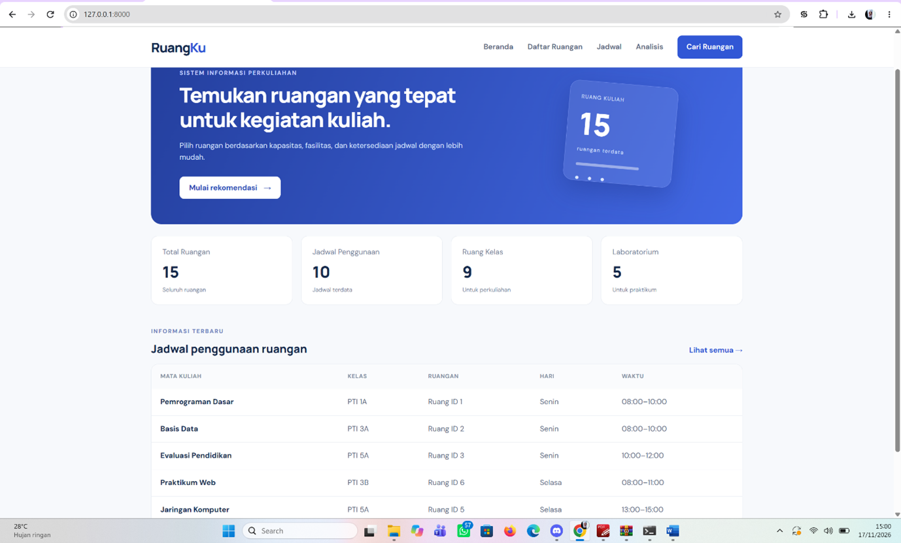
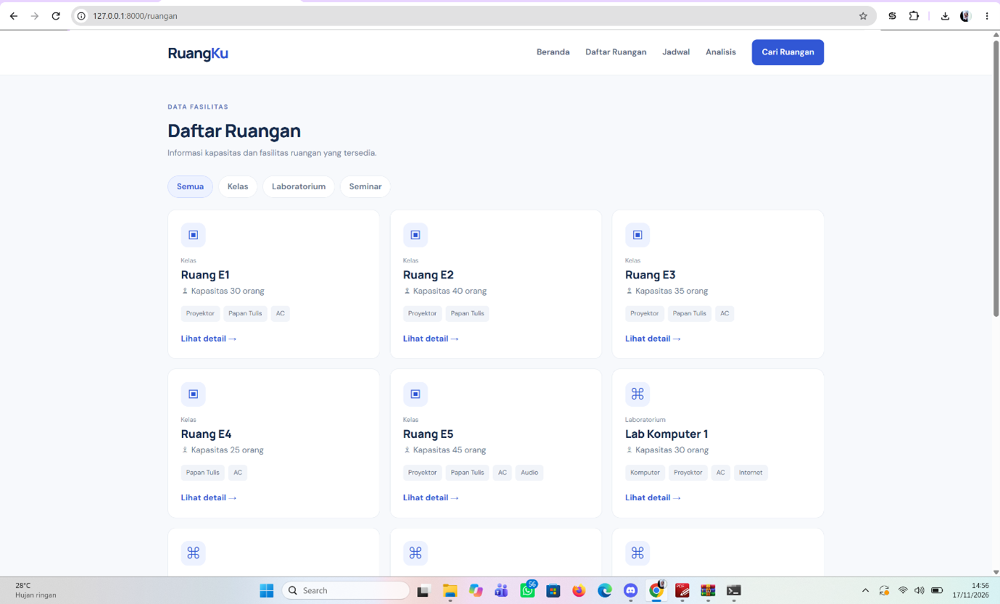
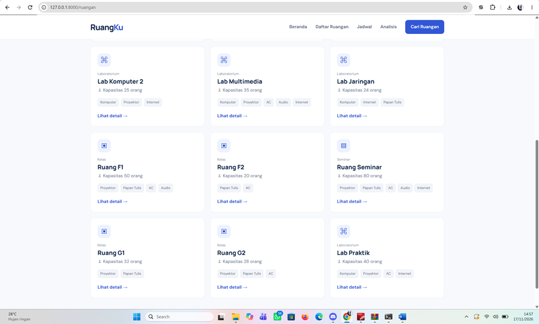
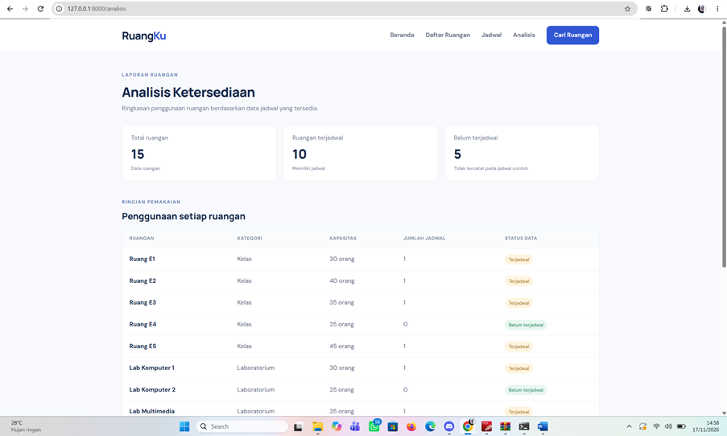
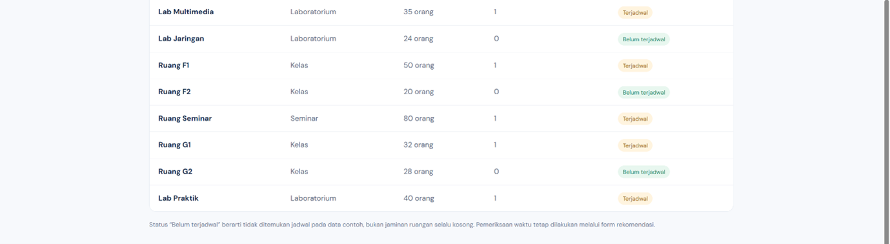
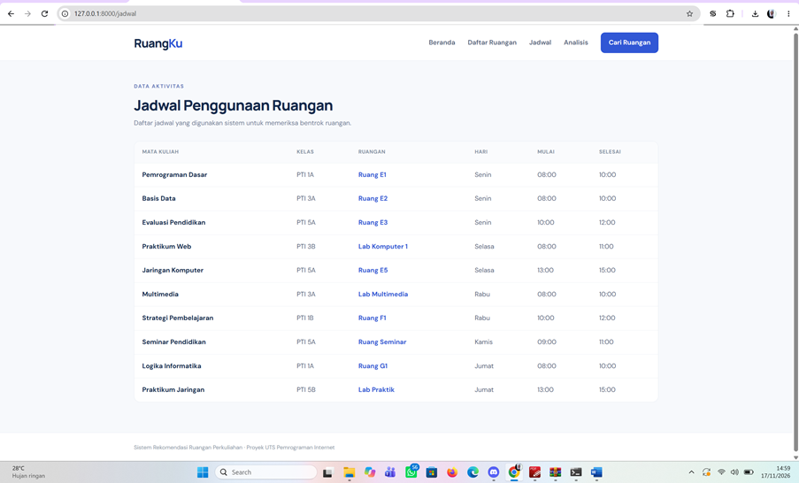

# SISTEM REKOMENDASI RUANGAN PERKULIAHAN

## Identitas Mahasiswa

- **Nama:** Asti Atiyah
- **NIM:** C2483207016
- **Kelas:** PTI5
- **Program Studi:** Pendidikan Teknologi Informasi
- **Universitas:** Universitas Muhammadiyah Tasikmalaya
- **Mata Kuliah:** Pemrograman Internet

## 1. Deskripsi Proyek

Sistem Rekomendasi Ruangan Perkuliahan merupakan aplikasi berbasis web yang dibuat menggunakan framework Laravel. Aplikasi ini bertujuan membantu pengguna menentukan ruangan perkuliahan yang sesuai berdasarkan kapasitas, fasilitas, hari, dan waktu penggunaan.

Permasalahan yang dihadapi adalah kesulitan memilih ruangan yang sesuai dengan kebutuhan perkuliahan. Pemilihan ruangan yang tidak tepat dapat menyebabkan kapasitas tidak mencukupi, fasilitas tidak tersedia, atau jadwal penggunaan ruangan bertabrakan.

Melalui aplikasi ini, pengguna dapat memasukkan kebutuhan perkuliahan dan mendapatkan rekomendasi ruangan berdasarkan hasil analisis sistem.

## 2. Fitur Aplikasi

Fitur yang tersedia dalam aplikasi meliputi:

- Halaman utama sistem rekomendasi.
- Menampilkan daftar ruangan.
- Menampilkan detail ruangan dan fasilitas.
- Formulir kebutuhan perkuliahan.
- Analisis ketersediaan ruangan.
- Hasil rekomendasi ruangan.
- Menampilkan alasan ruangan diterima atau ditolak.
- Menampilkan jadwal penggunaan ruangan.

## 3. Implementasi Routing, Controller, dan Blade View

Aplikasi menggunakan konsep MVC (Model-View-Controller) pada Laravel.

### A. Routing

Routing digunakan untuk mengatur alamat halaman aplikasi dan menghubungkannya dengan Controller.

Beberapa route yang digunakan:

| Route | Fungsi |
|---|---|
| `/` | Halaman utama |
| `/rooms` | Daftar ruangan |
| `/rooms/{id}` | Detail ruangan |
| `/recommendation` | Form kebutuhan perkuliahan |
| `/recommendation/result` | Hasil rekomendasi |
| `/analysis` | Analisis ketersediaan |
| `/schedules` | Daftar jadwal |
| `/about` | Informasi aplikasi |

### B. Controller

Controller digunakan untuk mengolah data dan menjalankan logika program.

Controller yang digunakan:

- **DashboardController:** Mengatur data dan tampilan halaman utama.
- **RoomController:** Mengolah data ruangan, detail ruangan, dan jadwal.
- **RecommendationController:** Mengolah kebutuhan perkuliahan dan menentukan rekomendasi ruangan.

### C. Blade View

Blade View digunakan untuk menampilkan hasil pengolahan data kepada pengguna.

Tampilan aplikasi dibuat menggunakan HTML dan CSS serta menerapkan fitur Blade seperti:

- `@extends`
- `@section`
- `@yield`
- `@foreach`
- `@if`

## 4. Logika Analisis dan Rekomendasi

Aplikasi menggunakan data berbentuk array PHP tanpa menggunakan database.

Sistem melakukan beberapa pemeriksaan berikut:

### A. Pemeriksaan Kapasitas

Sistem membandingkan kapasitas ruangan dengan jumlah mahasiswa.

Rumus:

**Selisih Kapasitas = Kapasitas Ruangan - Jumlah Mahasiswa**

Ruangan dinyatakan memenuhi syarat apabila kapasitasnya cukup untuk menampung seluruh mahasiswa.

### B. Pemeriksaan Fasilitas

Sistem memeriksa apakah fasilitas yang tersedia di ruangan sesuai dengan fasilitas yang dibutuhkan dalam perkuliahan.

Jika fasilitas yang dibutuhkan tidak tersedia, ruangan tidak masuk dalam rekomendasi.

### C. Pemeriksaan Konflik Jadwal

Sistem memeriksa jadwal penggunaan ruangan berdasarkan hari dan rentang waktu.

Jika terdapat jadwal lain pada ruangan yang sama dan waktunya bertabrakan, ruangan dinyatakan tidak tersedia.

### D. Penentuan Rekomendasi

Ruangan yang memenuhi persyaratan kapasitas, fasilitas, dan jadwal akan dimasukkan ke dalam daftar rekomendasi.

Hasil rekomendasi diurutkan berdasarkan selisih kapasitas terkecil agar ruangan yang paling sesuai ditampilkan terlebih dahulu.

Sistem juga menampilkan alasan rekomendasi atau penolakan ruangan. Jika tidak ada ruangan yang memenuhi seluruh persyaratan, sistem menampilkan informasi bahwa ruangan yang sesuai belum tersedia.

## 5. Screenshot Aplikasi

Berikut adalah dokumentasi tampilan aplikasi.

### A. Halaman Utama



### B. Halaman Daftar Ruangan




### C. Analisis Ketersediaam




### D. Jadwal Penggunaan Ruangan



### E. Masukan Kebutuhan Perkuliahan


## 6. Petunjuk Menjalankan Aplikasi

Pastikan PHP, Composer, dan Laravel sudah tersedia di komputer.

1. Clone repository:

   ```bash
   git clone https://github.com/USERNAME/NAMA-REPOSITORY.git
   ```

2. Masuk ke folder proyek:

   ```bash
   cd NAMA-REPOSITORY
   ```

3. Install dependency:

   ```bash
   composer install
   ```

4. Salin file konfigurasi:

   ```bash
   copy .env.example .env
   ```

5. Buat application key:

   ```bash
   php artisan key:generate
   ```

6. Jalankan aplikasi:

   ```bash
   php artisan serve
   ```

7. Buka browser dan akses:

   ```text
   http://127.0.0.1:8000
   ```

## 7. Teknologi yang Digunakan

- PHP
- Laravel
- HTML
- CSS
- Blade Template
- Git dan GitHub

## 8. Penutup

Dengan adanya Sistem Rekomendasi Ruangan Perkuliahan, diharapkan proses pemilihan ruangan menjadi lebih mudah, cepat, dan sesuai dengan kebutuhan perkuliahan.

Proyek ini dibuat untuk memenuhi tugas Ujian Tengah Semester mata kuliah Pemrograman Internet.
